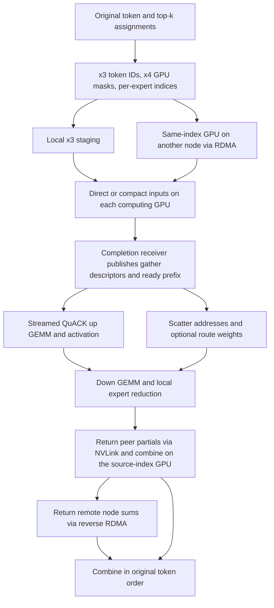

# One routed iteration

Follow one token owned by GPU `g` on node A. It can select experts on several GPUs and nodes. The forward path delivers an input row once per selected destination domain. The down path produces a contribution for each expert assignment. Returns and reductions reconstruct one row at the original token position.

## Processes, storage and setup

The torchrun launcher assigns one Python process to each local rank. The worker maps logical ranks to CUDA devices and NICs, loads PyTorch and the shared library into the same process, and installs a device allocator before native initialization. C++ requests typed buffers through a versioned callback. Python retains the tensors and callback, including aliases, until native teardown. The standalone executable uses the same `Proxy` implementation with its own allocation path. [Worker and allocator](../python/rdma_proxy_worker.py) · [Embedding contract](../include/rdma_proxy_c_api.h)

Across nodes, GPU `g` exchanges with GPU `g`. TCP exchanges connection/registration information and routing metadata. Each RC QP has a send worker and a CQ poller. The poller decodes immediate records and reposts receive WRs. With two NICs per GPU each PD registers the buffers separately. A claimed chunk uses the claiming QP's matching key pair. Within a node, CUDA IPC lets a source submit copies into the receiving GPU's allocations. [Connections](../native/src/rdma_connection.cpp) · [QP workers](../native/src/qp_worker.cpp) · [Hardware diagram](system_arch_graph_01.md)

The default benchmark fixes its routing table during setup. With per-iteration routing enabled, preparation installs a fresh table before releasing the forward path. `R[token, slot]` names a global expert. The production CUDA node-mask path bins and scans 256-token chunks, emits stable destination-node lists and rebuilds the expert lists. In each node slice, `x3` is the original token ID and the corresponding byte in `x4` encodes the GPUs selected on that node. Sorting is by descending source-relative mask with stable token order for ties. Bit `(g - destination_gpu) mod gpus_per_node` represents a destination; the native routing layer also provides normalized masks for consumers. Per-expert offsets delimit indices into the destination's input rows. For same-index traffic, those indices address the full x3 slice in the RDMA buffer. For other GPUs they address the x4-filtered compact sequence. Optional FP32 weights align with individual positions in the expert lists, including multiple experts for the same token. [Routing adapter](../native/src/router_routing.cpp) · [CUDA and CuTe metadata contracts](../metadata/README.md)

The default native routing path uses the raw CUDA entry points. A PyTorch extension builds from that same CUDA translation unit. The opt-in two-node benchmark backend loads the GPU experiment's shared library in each meon worker. A CUDA graph runs the seven CuTe metadata kernels, and a separate graph gathers from the rank's send tensor into its own local receive slice. The receiver can overlap the IPC exchange. Its completion gates the gather, which can overlap outstanding RDMA metadata traffic. Native installation consumes all 16 source views and the opposite node's same-index x3/x4 before payload dispatch. [Backend and timing boundaries](development.md#benchmark-metadata-backend) · [GPU exchange](../benchmarks/router_metadata_exchange2/README.md)

With direct GPU indices, QuACK reads the eight local-source lists in the destination GPU's IPC exchange records. For the eight remote sources the NIC writes the live indices into separate, registered GPU slots and delivers the full records to pinned host memory. The relay's outbound GPU records can still be in use when a remote write arrives. Separate incoming slots let sends and receives overlap. The exchange completes the writes and establishes GPU visibility before returning to the installer. The CPU uses its pinned lists for gather scheduling and scatter preparation. The installer clears the tails of shorter device lists to QuACK's common logical length in one kernel.

Meon also needs each GPU's own outgoing route to plan payload forwarding and look up expert assignments. During the exchange, extra blocks of the same receiver kernel write the three node offsets, the valid x3 and x4 rows for both destination nodes, and the original top-8 assignments into one reusable pinned host buffer per rank. The receiver completion event covers those writes. After exchange and staging finish, the installer validates the arrays in place by default. The benchmark profiling option `--no-benchmark-metadata-validation` skips the per-entry diagnostic scans and retains x3 address bounds and structural checks. Forwarding and return planning read the outgoing x3 and x4 slices directly. An assignment query reads the original expert IDs from the same buffer and supplies a weight of one for each requested assignment. At retirement, meon releases the outgoing route and the 16 incoming expert lists before the next exchange can overwrite them.

## Prepare, forward and publish

On refreshed two-node benchmark routes with direct device indices, concurrent up-GEMM and early local readiness, the worker installs the expert metadata, binds the live tensor views and resets the ready prefix. Once staging is complete, the notification receiver can publish batches from this GPU's own source. Meanwhile the native coordinator builds peer receive chunks and NVLink forwarding tables. Before sending payloads it exchanges the iteration-start marker with its same-index peer and waits for all eight local GPUs. The earlier Gloo barrier protects the previous iteration's borrowed buffers. Both barriers keep their existing peer protocols. [Native iteration boundaries](runtime.md#measured-iterations) · [Benchmark timing](development.md#benchmark-metadata-backend)

1. **Reset this generation.** Python resets the optional combine prefix/slots after the previous consumers have joined. Native preparation resets the iteration's gather state, ready flags, cursors, counters and return state as configured. Local iteration synchronization can span the GPU processes. On the Hopper multi-buffer early-launch path, native code writes zero on the publication stream, records the reset event for this iteration, and queues a compute-stream wait. Python binds the live up views and reserves scatter storage before handing the current route to the coordinator. The main thread submits QuACK while the coordinator reads the expert counts, registers this route’s scatter address slab against the fixed output buffers, and requests local publication. The receiver can now publish the first eligible local batch. The coordinator then starts the down-wave job and constructs the down runner with the registered slab views. It starts return maps, prepares returns and drives peer transport. The main thread joins setup before recording the up end event and launching down. The ordinary launch path uses a two-party barrier between Python and the coordinator.
2. **Move input rows.** With local staging, the own-node x3 payload is gathered before iteration zero in fixed-route mode and before each payload iteration in dynamic mode. Each iteration forwards selected rows from that input to other local GPUs. Remote RDMA writes pack x3 rows into the same-index peer receive buffer. In dynamic mode the local gather runs on a separate CUDA stream and can overlap the metadata exchange. Both complete before payload RDMA starts. The local NVLink forwarding of staged rows can overlap payload RDMA. Remote NVLink forwarding waits for the local drain in this mode. Direct same-index inputs alias the RDMA receive allocation. Forwarded inputs have separate compact cursors per global source and destination. CUDA copy streams, the optional preparation/submit/epilogue threads and the notification receiver run independently. [Forwarding implementation](../native/src/proxy.cpp)
3. **Establish visibility.** Forward completion requires the configured copy completion event/synchronization. Direct RDMA consumers also require owner visibility, including a GPUDirect flush where the platform needs it. Only then can the sender expose a completed range through the destination's per-source FIFO. Early local readiness uses a separate mailbox for this GPU's already-staged x3 range. Later local completions still account for peer copies and round retirement.
4. **Select and publish work.** The receiver updates contiguous source readiness. The default schedules eligible work after each data notification. Complete-round mode collects completions across sources for one iteration, phase, source-node context and batch ordinal, then schedules once. Zero-length and end markers distinguish an empty destination or exhausted source from a delayed producer. Future records are drained without exposing their rows early. Both policies schedule complete expert M clusters and an eligible final partial cluster. The receiver uploads the descriptors, then updates the ready-row prefix on the publication stream. Per-entry and coalesced publication change how many writes expose the same ordered descriptors. Published rows are immutable for the iteration. [Scheduler and protocol details](runtime.md#optional-complete-round-gather-scheduling)

## Up, scatter and down

With dynamic routing, up-GEMM sizes its output from the longest active source
index list, since all source lists use the same padded length. At startup and
on growth, the worker reserves an extra 1/64 of that length per source, rounded
up and capped at the source index capacity. If the reservation runs out of GPU
memory, the worker retries with the required size. QuACK receives a view sized
to the current route on every iteration.

The multi-input up table contains `[expert, cid_n_base, start_0, end_0, …]`. The second column is the first N-cluster index of the swizzle group. Each half-open range addresses that source's padded int32 `A_idx` array. Source order must agree across tables, indices, weights and input buffers. A descriptor's packed output begins at the sum of the starts. N groups repeat the same M work. The persistent up kernel waits for ready rows and gathers from those sources while more transfers are in flight.

On Hopper, `--pooled-up-gemm` allocates one `X_pool` per destination GPU before transport setup. Slice `source_node * gpus_per_node + source_gpu` holds up to `num_tokens` received rows. Local staging and forwarded NVLink copies land in these slices, and a remote same-index source has its slice registered for direct RDMA writes. At teardown, each forwarder closes its IPC imports before unlinking its notification object. The pool owner waits for those objects to retire before releasing storage. If it cannot confirm closure, it retains the exported pool for the process lifetime.

When the scheduler selects an M batch, it walks each logical range in source order and appends `slice_base + source_A_idx[position]` starting at the sum of **all** range starts. The list position identifies the expert assignment and its weight. The index value identifies the received row, including after compact forwarding. The N groups reuse these flat indices with four-column descriptors `[expert, sum(starts), sum(ends), cid_n_base]`. The receiver orders index and descriptor uploads after payload visibility and before publishing their ready prefix. Down scatter and projection checks retain the original logical ranges and their list positions.

Native allocation and QuACK must agree on `cta_tile_m * cluster_m`. Hopper uses its per-CTA M tile. On Blackwell, the supported two-CTA MMA configurations split M across a pair. The worker resolves actual device capacity before table allocation. For SwiGLU the GEMM computes twice the requested activation width. Down consumes the activated rows on the same compute stream. A separate four-column down gather table, expert waves, bulk-row stores and ready publication are available. Explicit up/down CTA budgets and combine residency checks matter when a persistent consumer spins on another kernel's progress. [Worker runners](../python/rdma_proxy_worker.py) · [Geometry and residency](features.md)

GPU scatter preparation decodes one copy of each M descriptor from the completed up table, preserves the exact source/list position for weights, and compacts distinct used input rows in ascending order per source. Contributions from several local experts selected by one token reduce into the same destination. With N-tile-major output the next tile starts at a stride based on the **valid row count**. Padding/capacity does not participate in the reduction. Weighted down multiplies each FP32 accumulator by its route weight before conversion to the output type and additive store. Later combines sum those partials without applying the weight again.

CPU scatter borrows the final device address/weight storage. Per-batch publication copies each M batch's metadata before its gather readiness. Deferred mode packs from the completed host table. Threaded mode packs committed prefixes on a persistent native thread, outside the scheduler lock. Both one-copy modes wait for final gather submission and complete packing, upload the slab on the publication stream, then record an event. Before down, the main host thread waits for **this iteration's record submission**, then queues a compute-stream wait for that event. The native coordinator continues driving communication during the bounded host wait. Staging, the event and the owning tensors survive the transfer. [Scatter ABI](../include/rdma_proxy_c_api.h) · [Publication tests](../tests/python/test_cpu_scatter_publication.py)

For refreshed dynamic routes with threaded CPU scatter and down expert-wave ready publication, each proxy reserves a pinned host slab and a matching device slab during initialization. On the early local-publication path the coordinator starts the wave job after requesting the local rows. A dedicated C++ thread builds the down work table and its wave-ready prefixes directly into the pinned slab. If the last gather descriptor was already submitted when the wave job starts, the worker observes that iteration’s recorded final-gather state. After both CPU construction and submission of the last up-gather descriptor and ready-row update, the worker enqueues one H2D copy of the live bytes on the publication stream and records the current iteration’s event. The down stream waits on this event, the scatter upload and QuACK’s remaining setup. Python joins the previous iteration’s GPU readers before reusing the allocation. Warmup and iteration zero share their eager schedule. Empty routes skip the transfer. [Native builder](../native/src/down_wave_schedule.cpp) · [Embedding contract](../include/rdma_proxy_c_api.h)

## Return, reduce and retire

On a refreshed dynamic route with threaded CPU scatter, the scatter worker can build the compact destination lookup from the installed expert indices while the gather publisher feeds up-GEMM. The worker then packs all committed gather ranges, including any that arrived during lookup construction. The host counts become visible before NVLink return copies are armed.

A separate return-map worker builds the intra-node map from source masks and the optional inter-node map from outgoing token indices. Only their domain lengths are needed to bind the current views. The maps share one pinned allocation and one fixed-address device allocation across iterations. After both construction and the last up-gather ready submission, one H2D and an event on the publication stream make both maps available. The combine readers wait for this iteration’s event in addition to their existing data readiness dependencies. An empty local expert route still needs maps for any contributions from other GPUs. [Worker ABI](../include/rdma_proxy_c_api.h)

Iteration preparation resets return readiness counters and prepares the per-peer RDMA return chunks from their live row counts. On the concurrent local publication path this runs after the local-ready request, independently of when QuACK submission returns. The combine counters are reset on the compute stream before its mapping-ready event releases the combine stream. These chunk descriptors tell the transport which ranges to send. [RDMA return preparation](../native/src/rdma_return.cpp)

| Stage | Producer, consumer and completion evidence |
| --- | --- |
| Down → same-node returns | The worker schedules valid counts before down, or reuses the fixed CPU counts. Whole-buffer return waits for the recorded down-done event. Per-group return can start from the mapped, system-release down prefix. Return copies run on a dedicated stream. Each logical producer visits peers cyclically starting at its successor, keeping all source-node spans for a destination together. |
| Return synchronization → intra-node combine | Optional batch-start synchronization covers one column group across **all** local producers, including empty groups. A waiting receiver retries while servicing forward notifications. Copy completion precedes return notification. The receiving proxy aggregates complete incoming group prefixes and can publish them to the GPU. The combine stream waits on the mapping-ready event and gates reads on readiness while down continues. It sums retained local output and returned peers in computing-GPU order. |
| Intra-node combine → reverse RDMA | Each source node has its own packed output domain. The combine CTAs publish a completed column-group prefix after stores, including the mapped prefix needed by native RDMA. Existing QP workers send groups over registered memory after their forward work. The coordinator waits for outgoing and incoming markers and required receive visibility. |
| Node sums → original token order | For each original source GPU, the final kernel inverts its outgoing x3 lists, reads the local sum and any remote sums, and writes a dense row per original token. An absent contribution is zero. Single-node mode uses the local domain directly. |

[Return copies](../native/src/return_copies.cpp) · [IPC exchange](../python/rdma_return_exchange.py) · [Reverse RDMA](../native/src/rdma_return.cpp) · [Intra-node combine](../python/intra_node_combine.py) · [Original-token combine](../python/inter_node_combine.py)

After native completion, the worker joins the compute event, reads any requested readiness trace, completes the same-node return exchange, joins the combine work and waits for peer readers. Optional projection validation uses chunked FP32 references, the actual descriptors and independent source assignments where available. With end-of-iteration reset, it clears down destinations **after** all these readers and checks, waits for that reset even on the final iteration, and charges it to the completed iteration. The default clears before down. Wave and ready-prefix resets retain their separate ordering. [Numerical reference](../python/projection_validation.py) · [Repeated composition tests](../tests/python/test_worker_composition.py)

If setup fails with an early up-GEMM polling, the publisher preserves the submitted prefix, uploads zero-length multi-buffer descriptors for the remaining rows and releases the kernel. These descriptors have empty input and output ranges. The failed iteration proceeds to teardown. The worker aborts an active combine when unwinding, synchronizes the compute stream, joins the coordinator and shuts down/destroys the native handle while the borrowed storage is still alive. Native workers must retire pending copies/packing and propagate timeout or cancellation. Successful IPC teardown waits for workers to stop, closes imported handles, waits for peers to close theirs, then releases exports. Partial setup or failed shutdown retains potentially shared allocations for the process lifetime. [Exceptional teardown tests](../tests/python/test_return_exchange_cleanup.py)
